## Задание 1

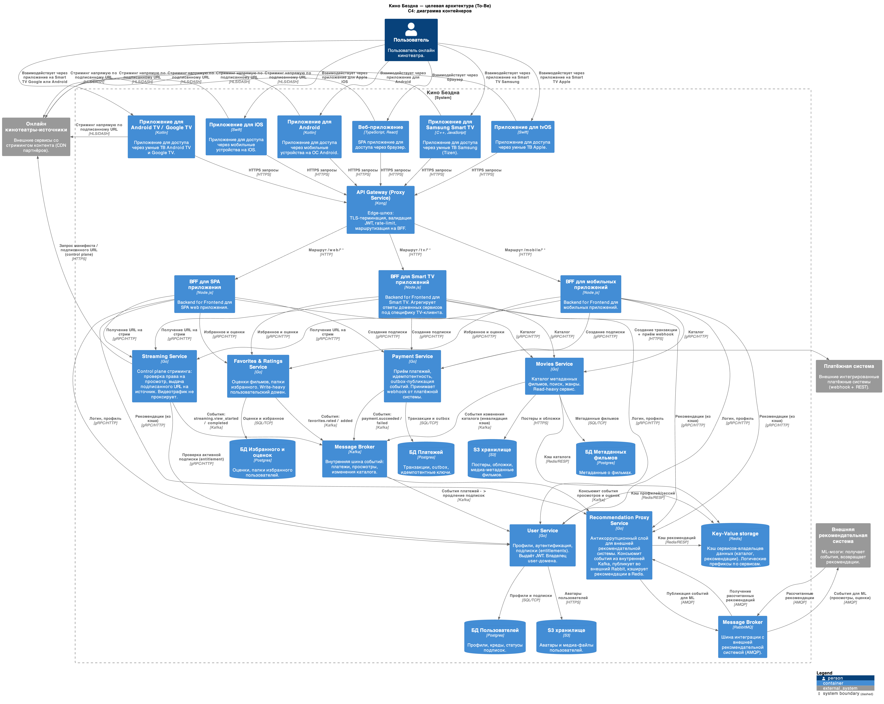

*[Картинка](/diagrams/c4_container_to_be/c4_container_to_be.png) — [PlantUML](/diagrams/c4_container_to_be/c4_container_to_be.puml)*

> **Комментарий** Лэндскейп разработчиков кинобездны не предусматривает фронт разработчиков, однако упомянуты интеграции через браузер, мобильные приложения и SmartTV. Подразумеваю что разработчики для этого есть, значит есть экспертиза в JS стэке.

## Задание 2

### Реализованное решение

Реализованы два сервиса на Python + FastAPI:

- [Proxy](src/microservices/proxy) — API Gateway с постепенным переключением запросов фильмов с монолита на Movies Service.
- [Events](src/microservices/events) — API событий Movie/User/Payment, producer и consumer Kafka с обработкой событий в логах.

При `GRADUAL_MIGRATION=true` процент задаётся через `MOVIES_MIGRATION_PERCENT`: 0 — монолит, 100 — Movies Service. При выключенном флаге все запросы фильмов идут в Movies Service. Проверены значения 0, 50 и 100%.

Postman: **22 запроса, 42 проверки, 0 ошибок**.

> **Комментарий** В Postman исправлен запуск, сама коллекция запросов и проверки не менялись. В `package.json` добавлен уже указанный в скрипте отчётчик `htmlextra`, а Newman обновлён до совместимой с ним версии 6. Удалён `template: 'default'`: отчётчик принимал это за путь к несуществующему файлу. `yargs` обновлён в пределах 17.x, `package-lock.json` пересоздан npm.

> **Комментарий** В `docker-compose.yml` добавлены healthcheck и ожидание готовности БД, Kafka и Events: обычный `depends_on` ждёт только запуска контейнера. Для одного брокера установлен replication factor служебного топика Kafka равным 1. Events не использует PostgreSQL, поэтому его зависимость от БД убрана. Устаревшее поле `version` удалено.

> **Комментарий** В `.gitignore` добавлены кэш Python и `.venv`, чтобы не включать их в коммиты. README сокращены и содержат инструкции запуска; результаты и скриншоты собраны в этом файле.

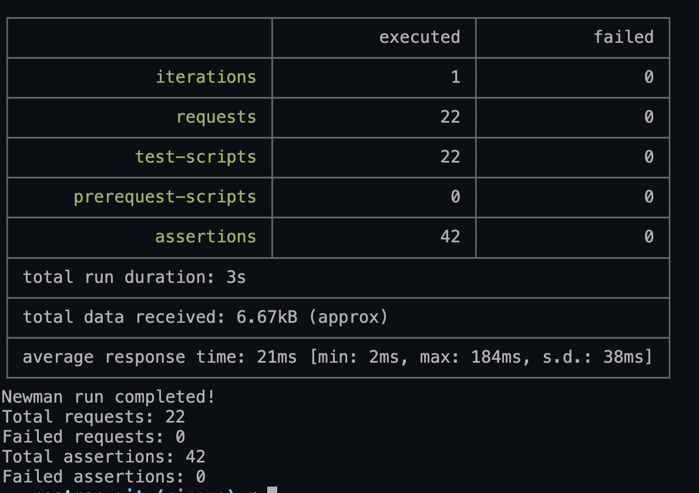

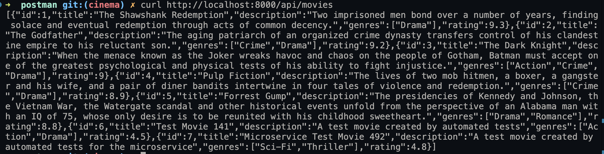

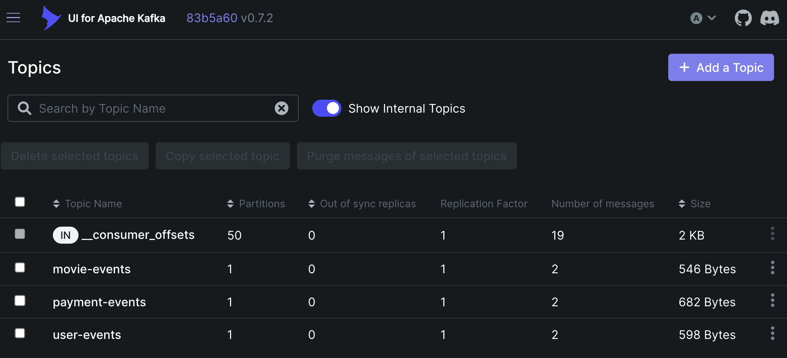

## Задание 3

### Реализованное решение

- [CI/CD](.github/workflows/docker-build-push.yml) — тестирование, сборка и публикация четырёх образов в GHCR для AMD64 и ARM64. Workflow запускается при push в любую ветку; тесты выполняются перед публикацией.
- [Kubernetes](src/kubernetes) — Deployment и Service для Proxy и Events, Ingress и конфигурация Feature Flag. Проверены HTTPS `/api/movies`, обработка событий и переключение 0/100%.

> **Комментарий** В существующих workflow обновлены версии actions и Node.js, API-тесты вынесены в переиспользуемый job. Фиксированные `sleep` заменены ожиданием готовности сервисов, зависимости устанавливаются через `npm ci`, отчёты сохраняются в артефактах. Это делает запуск тестов воспроизводимым и блокирует публикацию при ошибках.

> **Комментарий** В Kubernetes исправлены пути образов на свой GHCR; `IfNotPresent` позволяет использовать локально загруженные образы. В ConfigMap добавлены адрес Events и параметры Kafka. Некорректная заготовка registry secret заменена валидным пустым Docker config; для приватных образов нужен свой secret. В `kubernetes.environment.json` исправлено только название окружения — URL оставлены прежними. В Go-сервисах менялась только конфигурация развёртывания.

> **Комментарий** Для ARM64 выбран ZooKeeper 3.9 и исправлены пути его постоянного хранилища. В Kafka уменьшен heap, добавлена startup probe, топики создаются автоматически вместо запуска дополнительных JVM при старте. Отключены service links, чтобы Kubernetes не добавлял лишние `KAFKA_*` переменные. Резерв CPU PostgreSQL и Kafka уменьшен для двухъядерного Minikube: иначе Proxy оставался в `Pending`. Эти же исправления перенесены в Helm.

Для локальной проверки образы собраны через `bash src/kubernetes/load-local-images.sh`, установка выполнена через `bash src/kubernetes/deploy.sh`.

Postman (`npm run test:kubernetes` из `tests/postman`): **22 запроса, 42 проверки, 0 ошибок**. Проверка workflow через `actionlint` также пройдена.

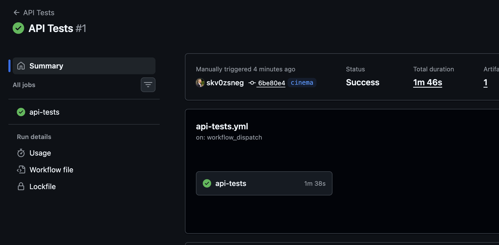

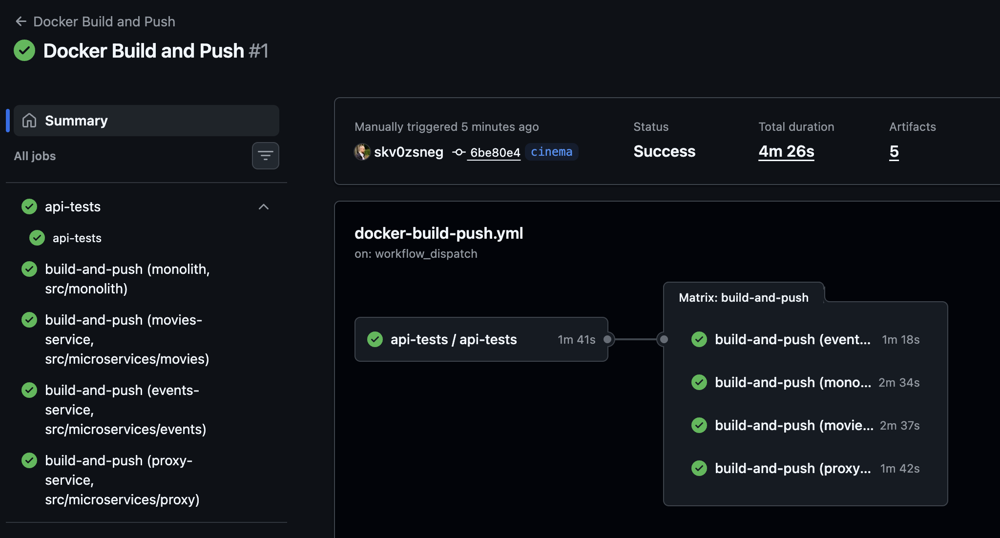

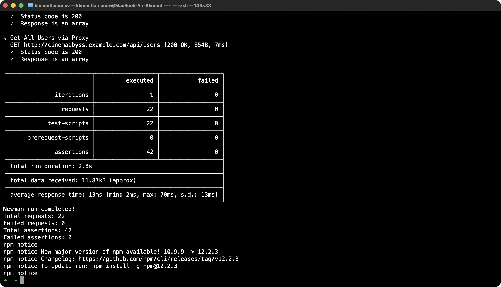

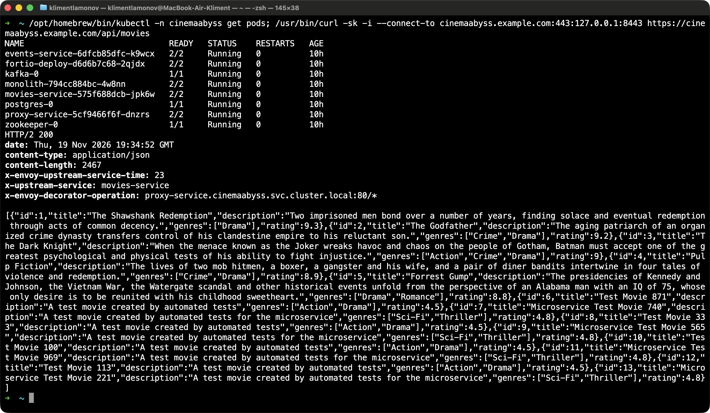

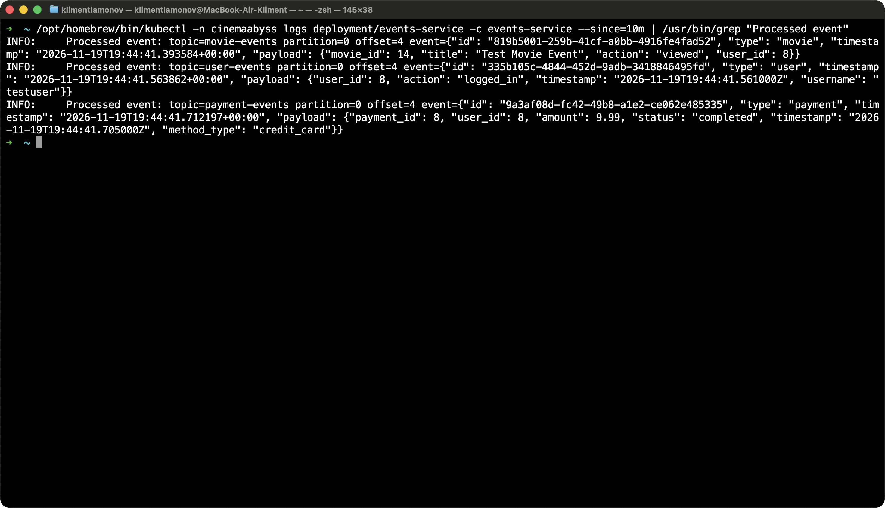

## Задание 4

### Реализованное решение

Доработан [Helm chart](src/kubernetes/helm). Образы, ресурсы, namespace и Feature Flag настраиваются через values и параметры установки. При изменении процента миграции приложения автоматически перезапускаются.

> **Комментарий** В существующих шаблонах namespace берётся из `.Release.Namespace`, чтобы работал параметр `--namespace`. Исправлен адрес `movies` на `movies-service`, добавлены параметры Events и Kafka. Registry secret стал необязательным, его имя настраивается отдельно; значения Secret заключены в кавычки. Checksum-аннотации нужны, чтобы изменение ConfigMap или Secret запускало rollout, а приложения получали новые переменные окружения.

```bash
helm upgrade --install cinemaabyss src/kubernetes/helm \
  --namespace cinemaabyss --create-namespace --wait --timeout 5m
```

Проверена чистая установка после удаления ручного деплоя. Релиз — `deployed`, HTTPS возвращает фильмы, Postman — **42/42**.

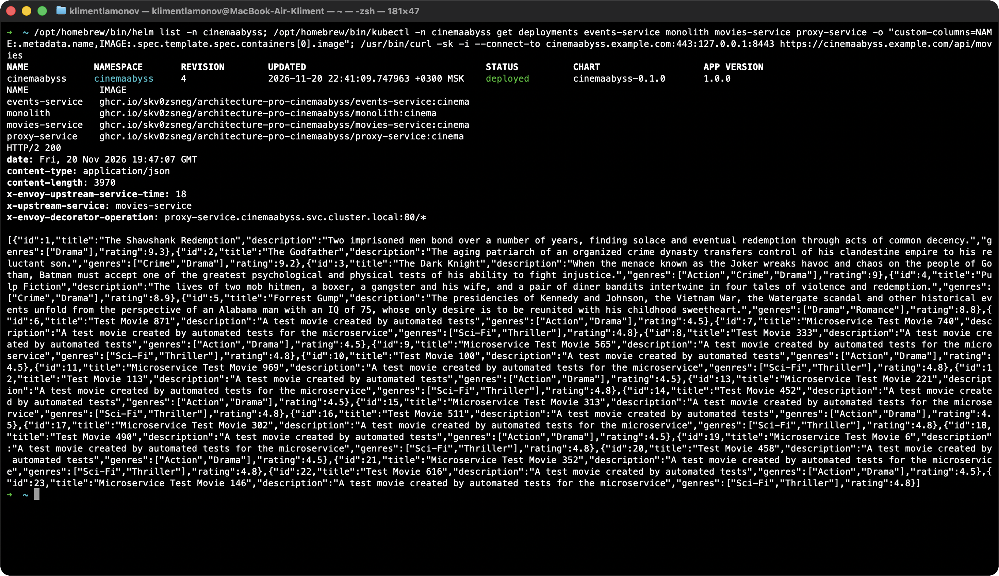

## Задание 5

### Реализованное решение

Развёрнут Istio 1.30.8. Для Monolith и Movies настроены [Circuit Breaker и отключение повторов запросов](src/kubernetes/circuit-breaker-config.yaml). Те же политики доступны в Helm через `istio.enabled=true`. Для приложений и Fortio включена sidecar injection.

> **Комментарий** В существующих Service HTTP-порты названы `http` для определения протокола в Istio. PostgreSQL, Kafka и ZooKeeper исключены из injection: для этой проверки sidecar нужен у HTTP-приложений и Fortio. В Fortio включён вывод overflow-счётчиков, скрытых по умолчанию. Лимит соединений и запросов равен 1 для наглядной демонстрации; скрипт проверяет и ответы 503, и рост счётчиков за текущий прогон.

Проверка после установки Istio и включения injection:

```bash
kubectl apply -f src/kubernetes/fortio.yaml
bash src/kubernetes/check-circuit-breaker.sh
```

Fortio отправляет по 500 запросов с параллелизмом 50. Movies: **6 ответов 200 и 494 ответа 503**; Monolith: **12 ответов 200 и 488 ответов 503**. У обоих сервисов выросли overflow-счётчики. Обычные Postman-тесты после нагрузки — **42/42**.

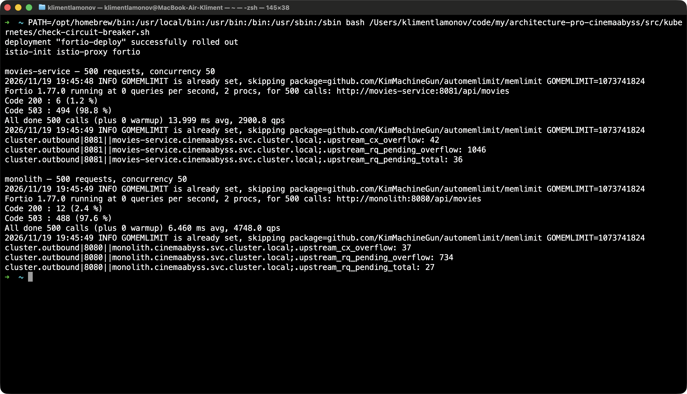
